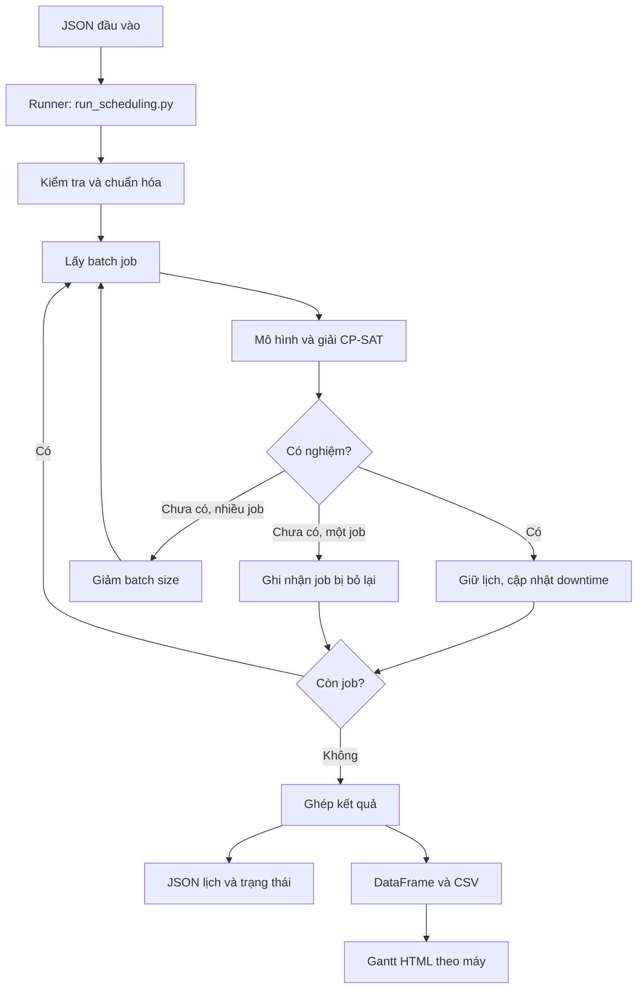

# CP-SAT Job Shop Scheduler — Tối ưu lịch sản xuất

> Từ danh sách công việc, năng lực máy và lịch ngừng hoạt động, hệ thống tạo lịch trả lời ba câu hỏi: **làm công đoạn nào, trên máy nào, vào thời điểm nào?**

Dự án giải bài toán **lập lịch sản xuất nhiều công đoạn, có nhiều máy thay thế** bằng Google OR-Tools CP-SAT. Đầu ra gồm lịch JSON/CSV và biểu đồ Gantt tương tác để kiểm tra, trao đổi và trình bày kế hoạch.

Phần business giải thích **bài toán → mục tiêu → ràng buộc → ví dụ**, đặc biệt quy tắc deadline 70% được diễn giải từng bước trước khi đưa công thức. Các phần tiếp theo mô tả phương pháp giải và hướng dẫn sử dụng dự án.

## Mục lục

1. [Bài toán kinh doanh](#1-bài-toán-kinh-doanh)
2. [Khái niệm và ví dụ](#2-khái-niệm-và-ví-dụ)
3. [Các ràng buộc — constraints](#3-các-ràng-buộc--constraints)
4. [Mục tiêu tối ưu](#4-mục-tiêu-tối-ưu)
5. [Phương pháp giải và chia batch](#5-phương-pháp-giải-và-chia-batch)
6. [Kiến trúc và công nghệ](#6-kiến-trúc-và-công-nghệ)
7. [Dữ liệu đầu vào](#7-dữ-liệu-đầu-vào)
8. [Cài đặt và chạy](#8-cài-đặt-và-chạy)
9. [Đọc kết quả](#9-đọc-kết-quả)
10. [Cấu hình thuật toán](#10-cấu-hình-thuật-toán)
11. [Kiểm thử và xử lý sự cố](#11-kiểm-thử-và-xử-lý-sự-cố)
12. [Giới hạn và hướng phát triển](#12-giới-hạn-và-hướng-phát-triển)
13. [Câu hỏi thường gặp](#13-câu-hỏi-thường-gặp)

## 1. Bài toán kinh doanh

### 1.1. Hệ thống cần quyết định điều gì?

Giả sử nhà máy nhận nhiều lô sản xuất. Mỗi lô phải đi qua một số công đoạn theo thứ tự, chẳng hạn **gia công → kiểm tra → lắp ráp**. Một công đoạn có thể chạy trên nhiều máy, nhưng thời gian xử lý trên từng máy khác nhau. Máy còn có lịch nghỉ và bảo trì.

Lập lịch sản xuất là quyết định đồng thời ba điều:

| Câu hỏi | Quyết định cần đưa ra | Ví dụ |
| --- | --- | --- |
| **What operation?** | Công đoạn nào của job cần thực hiện, theo trình tự nào? | Job A cần OP1 trước OP2 |
| **Which machine?** | Chọn máy nào trong các máy đủ điều kiện cho công đoạn? | OP1 có thể chạy trên M1 hoặc M2; chọn đúng một máy |
| **When?** | Bắt đầu và kết thúc khi nào? | OP1 chạy từ 08:00 đến 08:10; OP2 bắt đầu sau 08:10 |

Đầu ra cần là một lịch cụ thể: **mỗi công đoạn được gán một máy và một khoảng thời gian**, đồng thời không vi phạm các quy tắc sản xuất.

### 1.2. Vì sao bài toán khó?

Các lựa chọn liên quan đến nhau. Khi một job dùng máy trong một khoảng thời gian, các job khác không được dùng máy đó cùng lúc. Công đoạn bị chậm còn làm các công đoạn sau của cùng job phải chờ.

Ví dụ: job A có một công đoạn xử lý được trên hai máy:

| Máy | Thời gian xử lý | Máy có thể bắt đầu lúc nào? | Công đoạn kết thúc lúc nào? |
| --- | --- | --- | --- |
| M1 — nhanh hơn | 6 phút | 08:10, vì trước đó đang bận | 08:16 |
| M2 — chậm hơn | 8 phút | 08:00, vì đang trống | 08:08 |

Trong tình huống này, chọn M2 giúp công đoạn kết thúc sớm hơn dù M2 xử lý chậm hơn. Nếu M2 cũng cần cho job B, việc chọn M2 cho A lại ảnh hưởng lịch của B. Vì vậy, **chọn máy nhanh nhất cho từng công đoạn riêng lẻ chưa chắc tạo ra lịch tốt nhất cho cả kế hoạch**.

Độ khó tăng khi cùng lúc phải xét:

- Nhiều job cạnh tranh cùng máy.
- Mỗi công đoạn có nhiều máy thay thế với tốc độ khác nhau.
- Công đoạn sau phải chờ công đoạn trước.
- Giờ nghỉ kéo dài thời gian chiếm máy; downtime làm máy không khả dụng.
- Deadline yêu cầu công đoạn đạt một mức tiến độ trước hạn.
- Toàn bộ công đoạn phải kết thúc trong khoảng thời gian lập kế hoạch.

### 1.3. Mục tiêu: có lịch khả thi trước, tối ưu sau

Một lịch **khả thi — feasible** là lịch thỏa tất cả ràng buộc bắt buộc. Ví dụ, hai job cùng chiếm một máy lúc 08:05 thì lịch không khả thi, dù thời điểm hoàn thành trên giấy có vẻ sớm.

Sau khi có lịch khả thi, hệ thống tìm lịch tốt hơn theo các tiêu chí tối ưu.

| Mục tiêu business | Ý nghĩa | Vai trò trong mô hình |
| --- | --- | --- |
| **Có thể tổ chức sản xuất theo lịch** | Đúng trình tự, đúng máy, không trùng tài nguyên, tôn trọng lịch máy | Ràng buộc bắt buộc |
| **Hoàn thành kế hoạch sớm hơn** | Giảm thời điểm job cuối cùng kết thúc | Tiêu chí tối ưu — makespan |
| **Giảm khoảng rảnh trên máy đang được dùng** | Hạn chế các khoảng trống giữa những lần máy xử lý công việc | Tiêu chí tối ưu — idle máy |
| **Kiểm soát tiến độ trước deadline** | Công đoạn có deadline phải đạt ít nhất 70% thời gian xử lý trước hạn | Ràng buộc bắt buộc, không phải điểm phạt được phép đánh đổi |

Ví dụ, hai job độc lập A và B đều cần 6 phút xử lý, có thể dùng M1 hoặc M2. Không có nghỉ, downtime hoặc deadline trong ví dụ này:

| Phương án | Máy M1 | Máy M2 | Thời điểm hoàn thành cuối |
| --- | --- | --- | --- |
| Xếp lần lượt trên một máy | A: 08:00–08:06; B: 08:06–08:12 | Không dùng | 08:12 |
| Phân bổ sang hai máy | A: 08:00–08:06 | B: 08:00–08:06 | 08:06 |

Cả hai lịch đều khả thi. Xét riêng mục tiêu hoàn thành sớm, phương án thứ hai tốt hơn. Trong bài toán thực tế, hệ thống còn cân nhắc các thành phần khác của hàm mục tiêu.

## 2. Khái niệm và ví dụ

### 2.1. Thuật ngữ cần hiểu

| Thuật ngữ | Cách hiểu theo nghiệp vụ |
| --- | --- |
| **Job** | Một công việc/lô sản xuất cần được xếp lịch |
| **Operation** | Một công đoạn trong job, ví dụ OP1 hoặc OP2 |
| **Machine** | Máy thực hiện công đoạn |
| **Alternative machine** | Một trong các máy được phép chọn cho cùng công đoạn |
| **Processing time** | Tổng số phút thực sự cần làm việc để hoàn thành công đoạn trên máy đã chọn |
| **Duration** | Số phút từ lúc bắt đầu đến lúc kết thúc công đoạn, gồm cả giờ nghỉ bị đi qua |
| **Break time** | Giờ nghỉ; công đoạn có thể đi qua nhưng phải kéo dài thời gian và vẫn giữ máy |
| **Downtime** | Thời gian máy bị chặn, ví dụ bảo trì; công đoạn không được chạy xuyên qua |
| **Deadline** | Mốc kiểm tra tiến độ của công đoạn: đến mốc này phải làm được ít nhất 70% processing time |
| **Horizon** | Giới hạn kết thúc của khoảng thời gian lập kế hoạch |
| **Makespan** | Thời điểm kết thúc muộn nhất của các job trong phạm vi đang xét |
| **Batch** | Nhóm job đưa vào thuật toán cùng một lần, khác với lô sản phẩm của một job |

### 2.2. Processing time khác duration như thế nào?

Một job có 3 sản phẩm và hai công đoạn:

| Công đoạn | Máy được chọn | Thời gian/đơn vị | Processing time cả job |
| --- | --- | --- | --- |
| OP1 | OP1-MC1 | 1,5 phút | `ceil(1,5 × 3) = 5` phút |
| OP2 | OP2-MC1 | 2 phút | `2 × 3 = 6` phút |

OP1 có giờ nghỉ từ phút 2 đến phút 5. Nếu bắt đầu tại phút 0:

| Khoảng thời gian | Hoạt động | Số phút xử lý thực được cộng |
| --- | --- | --- |
| Phút 0–2 | OP1 làm việc | 2 phút |
| Phút 2–5 | Nghỉ | 0 phút |
| Phút 5–8 | OP1 làm tiếp | 3 phút |
| Phút 8–14 | OP2 làm việc, sau khi OP1 hoàn thành | 6 phút cho OP2 |

```text
OP1: [làm 2 phút] → [nghỉ 3 phút] → [làm 3 phút] → kết thúc tại phút 8
OP2:                                              [làm 6 phút] → phút 14
```

Đối với OP1:

- **Processing time = 5 phút:** cần 5 phút làm việc thực để hoàn thành.
- **Duration = 8 phút:** 5 phút làm việc cộng 3 phút nghỉ.
- Máy OP1-MC1 bị giữ trong toàn bộ khoảng 0–8, kể cả phần nghỉ.

Khi tính tiến độ trước deadline, chỉ cộng **phút làm việc thực**. Đồng hồ trôi qua 8 phút không có nghĩa công đoạn đã xử lý được 8 phút.

## 3. Các ràng buộc — constraints

### 3.1. Tổng hợp quy tắc nghiệp vụ

| Ràng buộc | Quy tắc cần tuân thủ | Ví dụ |
| --- | --- | --- |
| **Precedence** | Công đoạn sau chỉ bắt đầu khi công đoạn trước kết thúc | OP1 xong 08:10 thì OP2 bắt đầu từ 08:10 trở đi |
| **Chọn đúng một máy** | Một công đoạn chọn một máy trong danh sách đủ điều kiện | Được chạy trên M1/M2 thì chọn M1 hoặc M2, không chia ra cả hai |
| **Machine no-overlap** | Một máy không xử lý hai công đoạn cùng lúc | A giữ M1 đến 08:10 thì B không thể dùng M1 lúc 08:05 |
| **Downtime** | Khoảng chiếm máy của công đoạn phải tránh thời gian bị chặn | Bảo trì 08:04–08:09 thì không xếp công đoạn 08:00–08:10 trên máy đó |
| **Break time** | Không bắt đầu/kết thúc trong vùng nghỉ bị cấm; đi qua giờ nghỉ thì cộng thời gian nghỉ | Cần xử lý 10 phút, đi qua nghỉ 5 phút thì duration là 15 phút |
| **Horizon** | Tất cả công đoạn kết thúc trong giới hạn lập kế hoạch | Horizon đến 09:00 thì công đoạn kết thúc 09:05 không được chấp nhận |
| **Deadline 70%** | Đến deadline của công đoạn phải xử lý thực được ít nhất 70% tổng processing time | Cần xử lý 10 phút thì phải làm được ít nhất 7 phút trước hạn |

Trong cách giải theo batch của dự án, lịch batch đã chốt còn được giữ cố định: batch sau không được chiếm các khoảng máy đã dành cho batch trước.

### 3.2. Trình tự công đoạn — precedence

Giả sử job A có trình tự `OP1 → OP2 → OP3`. Nếu OP1 kết thúc lúc 08:10:

- OP2 bắt đầu lúc 08:08: **không hợp lệ**, vì OP1 chưa hoàn thành.
- OP2 bắt đầu lúc 08:10: **hợp lệ về trình tự**, nếu máy và các quy tắc khác cho phép.
- OP2 bắt đầu lúc 08:15: **hợp lệ về trình tự**, nhưng job có thêm 5 phút chờ.

Không bắt buộc các công đoạn phải nối tiếp ngay lập tức; công đoạn sau có thể chờ máy. Điều bắt buộc là không bắt đầu trước khi công đoạn trước hoàn thành.

Trong dữ liệu, trình tự lấy từ danh sách `job.operations`. Cấu hình thứ tự hiển thị Gantt không thay đổi trình tự này. Các job khác nhau hiện chưa có ràng buộc phụ thuộc với nhau.

### 3.3. Chọn máy và tránh trùng lịch

Một công đoạn có thể đủ điều kiện chạy trên nhiều máy, nhưng sau khi lập lịch chỉ được chọn **đúng một máy**. Thời gian xử lý được lấy theo máy đã chọn.

Ví dụ, A dùng M1 từ 08:00 đến 08:10. Khi xếp B trên M1:

| Lịch của B | Hợp lệ về tài nguyên? | Lý do |
| --- | --- | --- |
| 08:05–08:15 | Không | A và B cùng chiếm M1 từ 08:05 đến 08:10 |
| 08:10–08:20 | Có | B bắt đầu ngay khi A nhả máy |
| 08:00–08:10 nhưng chạy trên M2 | Có, nếu M2 phù hợp và đang trống | Hai job dùng hai máy khác nhau |

Các kết luận trên mới xét tài nguyên; vẫn cần kiểm tra trình tự, deadline và lịch máy. Mô hình xử lý cả số lượng của job như một khối ở từng công đoạn, chưa chia một công đoạn lên nhiều máy hoặc chuyển một phần sản phẩm sang công đoạn sau.

### 3.4. Phân biệt break time và downtime

Cùng một khoảng 08:04–08:09, tác động của hai loại lịch khác nhau:

| Loại thời gian | Công đoạn cần 10 phút, dự định bắt đầu 08:00 | Cách xử lý |
| --- | --- | --- |
| **Break time — giờ nghỉ** | Làm 4 phút → nghỉ 5 phút → làm tiếp 6 phút | Có thể kết thúc 08:15; duration là 15 phút |
| **Downtime — máy bị chặn** | Khoảng dự định 08:00–08:10 đi vào downtime | Không được chạy xuyên; với dữ kiện này có thể đợi 08:09 rồi chạy đến 08:19 nếu các quy tắc khác cho phép |

Với break, máy vẫn bị giữ suốt công đoạn. Với downtime, không có cơ chế tách công đoạn để làm một phần trước bảo trì và phần còn lại sau bảo trì.

Giờ nghỉ không tạo tiến độ: dù công đoạn kéo dài thêm 5 phút, tổng số phút cần xử lý thực vẫn là 10.

Chi tiết theo code hiện tại: có thể kết thúc đúng lúc giờ nghỉ bắt đầu, hoặc bắt đầu đúng lúc giờ nghỉ kết thúc. Không được bắt đầu đúng đầu giờ nghỉ hay kết thúc đúng cuối giờ nghỉ. Preprocessing gộp các khoảng nghỉ/downtime chồng nhau hoặc tiếp giáp để tránh tính trùng.

### 3.5. Quy tắc deadline 70% — giải thích từng bước

#### A. Đọc quy tắc bằng một câu

> **Đến deadline, công đoạn phải làm việc thực được ít nhất 70% tổng thời gian xử lý cần thiết trên máy đã chọn. Phần còn lại có thể làm sau deadline, nhưng vẫn phải xong trong horizon.**

Ví dụ công đoạn cần **10 phút xử lý thực**:

```text
Tổng cần làm:             10 phút
Ít nhất trước deadline:  10 × 70% = 7 phút
Phần còn lại:             tối đa 3 phút xử lý sau deadline
```

Deadline ở đây là **mốc kiểm tra tiến độ**, không bắt buộc là thời điểm công đoạn đã hoàn thành 100%.

#### B. Không có giờ nghỉ: vì sao được kết thúc sau deadline?

Công đoạn bắt đầu 08:00, cần 10 phút xử lý, deadline là 08:07:

```text
08:00                         08:07                 08:10
  |---- làm việc 7 phút ---------|---- làm 3 phút ------|
  bắt đầu                       deadline              kết thúc
                                đã xử lý 7/10 = 70%
```

Tại 08:07, công đoạn đã làm được 7 phút trong tổng 10 phút cần làm. Nó **đạt quy tắc 70%**, mặc dù đến 08:10 mới kết thúc.

Nếu cùng công đoạn đó chỉ bắt đầu lúc 08:03:

```text
Trước deadline 08:07: làm từ 08:03 đến 08:07 = 4 phút
Tiến độ: 4 / 10 = 40% → không đạt
```

Việc cuối cùng vẫn hoàn thành công đoạn không khắc phục được chuyện tiến độ tại deadline đã không đạt. Thuật toán phải tìm thời điểm bắt đầu khác, máy phù hợp khác, hoặc kết luận chưa xếp được công đoạn với các điều kiện đang xét.

#### C. Có giờ nghỉ: đừng lấy thời gian đồng hồ làm tiến độ

Giữ nguyên processing time **10 phút** và bắt đầu **08:00**, nhưng thêm giờ nghỉ **08:04–08:09**. Công đoạn kết thúc lúc **08:15**:

```text
08:00       08:04                08:09                  08:15
  |-- làm 4 --|----- nghỉ 5 -------|------- làm 6 ---------|
```

**Trường hợp 1 — deadline 08:07, nằm trong giờ nghỉ:**

| Đoạn trước deadline | Số phút đồng hồ trôi qua | Số phút xử lý thực |
| --- | --- | --- |
| 08:00–08:04: làm việc | 4 | 4 |
| 08:04–08:07: đang nghỉ | 3 | 0 |
| **Tổng đến 08:07** | **7** | **4** |

Đã trôi qua 7 phút, nhưng mới làm được **4/10 = 40%**, nên **không đạt**. Chỉ phần nghỉ nằm trước deadline được trừ: 3 phút, không phải cả 5 phút nghỉ.

**Trường hợp 2 — deadline 08:12, sau khi đã làm tiếp:**

| Đoạn trước deadline | Số phút xử lý thực |
| --- | --- |
| 08:00–08:04: làm việc | 4 |
| 08:04–08:09: nghỉ | 0 |
| 08:09–08:12: làm tiếp | 3 |
| **Tổng đến 08:12** | **7** |

Đã làm được **7/10 = 70%**, nên **đạt**. Công đoạn vẫn cần 3 phút xử lý sau deadline và kết thúc 08:15.

Hai trường hợp có cùng giờ bắt đầu, cùng máy, cùng processing time và cùng giờ nghỉ. Chúng khác kết luận vì **mốc deadline khác nhau**.

#### D. Ba câu hỏi để tự kiểm tra một lịch

1. **Công đoạn cần tổng cộng bao nhiêu phút làm việc trên máy đã chọn?** Đây là processing time, không cộng giờ nghỉ.
2. **Từ lúc bắt đầu đến deadline, đã có bao nhiêu phút thực sự làm việc?** Chỉ cộng các đoạn làm việc; không cộng thời gian nghỉ hoặc thời gian sau khi công đoạn đã kết thúc.
3. **Số phút đã làm có đạt 70% tổng số phút cần làm không?** Đạt thì công đoạn thỏa riêng quy tắc tiến độ; vẫn phải kiểm tra các ràng buộc khác.

Bảng đối chiếu, tất cả ví dụ dưới đây đều cần 10 phút xử lý thực:

| Bắt đầu | Giờ nghỉ | Deadline | Đã xử lý trước hạn | Kết thúc | Đạt 70%? |
| --- | --- | --- | --- | --- | --- |
| 08:00 | Không | 08:07 | 7 phút — 70% | 08:10 | Có |
| 08:03 | Không | 08:07 | 4 phút — 40% | 08:13 | Không |
| 08:00 | 08:04–08:09 | 08:07 | 4 phút — 40% | 08:15 | Không |
| 08:00 | 08:04–08:09 | 08:12 | 4 + 3 = 7 phút — 70% | 08:15 | Có |
| 08:00 | 08:04–08:09 | 08:20 | Đã xong 10 phút — 100% | 08:15 | Có |

Hàng cuối chỉ tính đến 08:15 khi công đoạn đã hoàn thành. Không tính tiếp 08:15–08:20 thành tiến độ để ra kết quả lớn hơn 100%.

#### E. Những cách hiểu cần phân biệt

| Cách hiểu | Đúng với dự án? | Giải thích |
| --- | --- | --- |
| 70% thời gian xử lý thực của từng công đoạn | **Đúng** | So phút đã làm trước deadline với processing time trên máy đã chọn |
| 70% số lượng sản phẩm đã hoàn thành | Không | Mô hình chưa theo dõi tiến độ từng sản phẩm |
| 70% tổng thời gian từ bắt đầu đến kết thúc, gồm cả nghỉ | Không | Giờ nghỉ không tạo tiến độ |
| 70% các công đoạn trong job đã xong | Không | Kiểm tra từng công đoạn có deadline, không đếm công đoạn hoàn thành |
| Phải xong 100% trước deadline | Không | Có thể kết thúc sau deadline nếu đạt ngưỡng và vẫn nằm trong horizon |
| Có thể vi phạm 70% nếu lịch tổng thể tốt hơn | Không | Đây là ràng buộc cứng, không phải tiêu chí được phép đánh đổi |

Nếu công đoạn có nhiều máy, ngưỡng được tính theo **máy thực sự được chọn**. Ví dụ, máy M1 cần 10 phút thì phải làm ít nhất 7 phút trước hạn; M2 cần 20 phút thì cần ít nhất 14 phút. Không dùng thời gian của máy khác để kiểm tra.

Trong triển khai hiện tại, deadline lấy từ `operations[].deadline`. `job.deadline` là metadata, không tự truyền xuống công đoạn. Công đoạn thiếu deadline hoặc có `deadline: null` không áp dụng quy tắc này. Ngưỡng 70% chưa phải tham số cấu hình.

#### F. Công thức sau khi đã hiểu ví dụ

Gọi:

- `P`: tổng processing time trên máy đã chọn.
- `W`: số phút xử lý thực đã làm được trước deadline.
- `D`: deadline của công đoạn.

```text
W = min(thời điểm kết thúc, D) − thời điểm bắt đầu − phần giờ nghỉ trước D
Yêu cầu: bắt đầu ≤ D và 10 × W ≥ 7 × P
```

Chỉ trừ phần giờ nghỉ công đoạn thực sự đi qua và nằm trước `D`. Với trường hợp C.1: `W = 7 − 0 − 3 = 4`. Với C.2: `W = 12 − 0 − 5 = 7`, tính bằng phút tương đối từ 08:00.

Code dùng `10 × W ≥ 7 × P` để không làm tròn giảm ngưỡng. Nếu cần 3 phút xử lý thì làm được 2 phút mới là 66,7%, chưa đủ 70%. Với đơn vị nguyên một phút, phải làm được ít nhất 3 phút trước hạn.

**Câu có thể dùng khi thuyết trình:**

> Nếu một công đoạn cần 10 phút làm việc thì đến deadline phải làm được ít nhất 7 phút. Nghỉ không được tính là làm việc. Công đoạn có thể làm tiếp 3 phút sau deadline, nên quy tắc này kiểm soát tiến độ trước hạn, không bảo đảm hoàn thành hoặc giao hàng đúng hạn.

### 3.6. Ràng buộc dữ liệu và giả định

Để các quy tắc trên có ý nghĩa, dữ liệu cần nhất quán:

- Mỗi job có mã duy nhất và danh sách công đoạn theo đúng trình tự.
- Mã công đoạn không trùng trong cùng job; mỗi công đoạn có ít nhất một máy hợp lệ.
- Thời gian xử lý là số hữu hạn, không âm; khi tính từ `unit_duration`, cần cung cấp quantity phù hợp.
- `horizon`, deadline, processing time, break và downtime dùng cùng đơn vị; pipeline CSV/Gantt hiện dùng phút.
- Khoảng nghỉ/downtime có đầu nhỏ hơn cuối sau khi làm tròn.
- Horizon là số nguyên dương, deadline là số nguyên phù hợp, batch size là số nguyên dương.

Preprocessing kiểm tra định danh, máy, duration và khoảng lịch, đồng thời làm tròn lên và gộp lịch. Chưa có schema đầy đủ cho mọi trường, nên người chuẩn bị dữ liệu vẫn phải bảo đảm các giả định nghiệp vụ. Khi thiếu quantity, code hiện lấy 0; khi có `unit_duration`, giá trị này được ưu tiên để tính thời gian cả công đoạn.

## 4. Mục tiêu tối ưu

### 4.1. Lịch khả thi và lịch tốt khác nhau thế nào?

Ràng buộc giúp trả lời **“lịch này có được phép thực hiện không?”**. Hàm mục tiêu giúp trả lời **“trong các lịch được phép, lịch nào phù hợp hơn với ưu tiên sản xuất?”**.

Hệ thống cân nhắc năm thành phần:

| Thành phần | Cách hiểu theo business | Trọng số mặc định |
| --- | --- | --- |
| **Makespan** | Muốn job cuối cùng kết thúc sớm hơn trong phạm vi đang giải | `100` |
| **Idle máy** | Muốn giảm các khoảng máy rảnh trong khoảng thời gian được tính | `10` |
| **Cân bằng tải máy** | Muốn giảm chênh lệch tổng thời gian xử lý giữa các máy cùng operation, kể cả tải batch trước | `10` |
| **Thời gian chờ giữa operations** | Muốn operation sau của cùng job bắt đầu gần thời điểm operation trước kết thúc | `10` |
| **Thời điểm kết thúc theo nhóm công đoạn–máy** | Muốn các nhóm cùng công đoạn trên cùng máy kết thúc sớm hơn | `0` |

Các thành phần được cộng với trọng số. Vì vậy, hoàn thành sớm hơn có thể được đánh đổi với giảm khoảng máy rảnh. Đây không phải thứ tự ưu tiên tuyệt đối.

**Deadline 70% nằm ở phía ràng buộc**, không phải một phần điểm phạt trong hàm mục tiêu. Một lịch vi phạm 70% không được chấp nhận chỉ vì makespan ngắn hơn.

### 4.2. Hiểu đúng khoảng máy rảnh — idle

Ví dụ đơn giản, máy làm A từ 08:00 đến 08:05, không làm gì từ 08:05 đến 08:08, rồi làm B đến 08:13. Nếu không có khoảng bị chặn, máy có **3 phút idle** trước khi công việc cuối cùng kết thúc.

Trong mô hình, idle được tính từ mốc 0 đến lần kết thúc cuối trên máy trong batch hiện tại:

```text
Idle = thời điểm kết thúc cuối
     − tổng duration các công đoạn của batch hiện tại trên máy
     − phần downtime đã gộp nằm trước thời điểm kết thúc cuối
```

Nếu batch trước dùng máy phút 0–10 và batch hiện tại dùng phút 10–15, idle là `15 − 5 − 10 = 0`. Khoảng 0–10 đã dành cho batch trước nên không được coi là máy rảnh.

Duration đã gồm giờ nghỉ bị đi qua, nên phần nghỉ đó không bị tính lại thành idle. Máy không dùng trong batch có idle cost bằng 0; thời gian sau lần kết thúc cuối không được tính. Chỉ số này không tương đương mức sử dụng máy toàn ca hoặc OEE.

Hệ thống **tìm kiếm lịch tốt nhất trong tập các lịch feasible** theo các tiêu chí đã khai báo. Cách chia batch và giới hạn thời gian tìm kiếm hiện tại không bảo đảm tìm được tối ưu toàn cục cho toàn bộ job.

## 5. Phương pháp giải và chia batch

### 5.1. Từ business sang mô hình

Bài toán thuộc nhóm **Flexible Job-Shop Scheduling**: job có trình tự công đoạn, mỗi công đoạn có máy thay thế và thời gian xử lý tùy máy.

CP-SAT biểu diễn thời gian bằng biến số nguyên, chọn máy bằng biến Boolean, công đoạn bằng interval/optional interval, trình tự bằng bất đẳng thức và giới hạn máy bằng `NoOverlap`.

Đây là tối ưu dựa trên ràng buộc, không có bước huấn luyện machine learning. Chất lượng lịch phụ thuộc dữ liệu, mô hình và thời gian tìm kiếm.

### 5.2. Luồng xử lý batch

Giải toàn bộ job cùng lúc cho phép phối hợp trên phạm vi rộng hơn nhưng tăng độ khó tìm nghiệm. Dự án chia job thành nhóm để giới hạn kích thước mỗi lần giải:

1. Runner đọc và preprocessing dữ liệu một lần.
2. Chọn cách chia batch tại `run_scheduling.py`; mặc định hybrid với 10 job/batch cho lịch khởi tạo.
3. Giải batch với những khoảng máy đang bị chặn.
4. Có nghiệm thì giữ lịch, thêm các khoảng chiếm máy vào downtime.
5. Giải các job còn lại với lịch đã giữ.
6. Ghép kết quả, xuất JSON, CSV và Gantt.

Riêng `horizontal`, mặc định có thêm bước dồn lịch cuối trước khi xuất kết quả. Sau khi loại job lỗi, solver giải lại toàn bộ job còn lại trên **máy đã chọn**, dùng downtime gốc và ràng buộc giờ nghỉ/deadline/trình tự công đoạn. Mỗi operation chỉ được bắt đầu và kết thúc bằng hoặc sớm hơn lịch đã chốt; mục tiêu riêng của bước này là giảm tổng thời điểm bắt đầu và kết thúc. Do đó có thể lấp khoảng trống mở ra sau khi job lỗi bị giải phóng, kể cả kéo việc từ ca sau về ca trước. Thời lượng bao gồm nghỉ được tính lại khi thời điểm thay đổi; thứ tự các job trên cùng máy có thể thay đổi. Nếu bước dồn chưa tìm được nghiệm, giữ lịch khả thi trước đó. Bước này thêm một lần giải với giới hạn `MINUTES_TIMEOUT`. Đặt `SCHEDULING_COMPACT_HORIZONTAL = False` để tắt.

Sau bước dồn, mặc định thử khôi phục các job trong cả `infeasible_jobs` và `unscheduled_jobs`. Mỗi job được thử một lần theo thứ tự đầu vào, giải **toàn bộ operations cùng lúc**, cho phép chọn máy thay thế. Các khoảng máy của job đã xếp được được giữ cố định; sau mỗi lần khôi phục thành công, downtime và tải xử lý được cập nhật cho job tiếp theo. Job thành công được chuyển vào `solution`; các danh sách lỗi, `total_jobs` và `status` phản ánh kết quả lần thử lại, với `UNKNOWN` thuộc `unscheduled_jobs`. Bước này cũng chạy nếu giai đoạn ngang chưa có job hoàn chỉnh, hoặc bước dồn bị tắt/chưa có nghiệm. Đặt `SCHEDULING_RECOVER_HORIZONTAL = False` để tắt. Mỗi job thử lại có giới hạn `MINUTES_TIMEOUT`; không bảo đảm khôi phục tất cả job hay sử dụng tất cả máy.

Batch được **giải** lần lượt, nhưng batch sau vẫn có thể **chạy** trong khoảng trống của batch trước trên máy. Không có yêu cầu toàn bộ batch trước phải hoàn thành thì batch sau mới bắt đầu.

Chọn một trong ba chế độ bằng các biến đầu file `run_scheduling.py`:

```python
BATCH_DIRECTION = "hybrid"  # "vertical", "horizontal" hoặc "hybrid"
JOBS_PER_BATCH = AlgorithmsConfig.SCHEDULING_BATCH_SIZE  # mặc định 10
```

- **Dọc (`vertical`):** xếp toàn bộ operations của từng nhóm job (mặc định 1–10, rồi 11–20…). Giữ cách xử lý dọc trước đây.
- **Ngang (`horizontal`):** xếp OP1 của mọi nhóm job trước khi chuyển sang OP2, rồi OP3… `JOBS_PER_BATCH` giới hạn số job trong mỗi lần giải một operation. Các nhóm job ban đầu được giữ cố định; job thiếu operation hoặc đã lỗi không làm job của nhóm sau chuyển lên nhóm trước.

- **Hybrid (`hybrid`, mặc định trong runner):** tạo lịch bằng horizontal (gồm dồn/khôi phục nếu bật), rồi giải lại những nhóm job liên quan trên **toàn bộ route**, cho phép đổi máy và đổi thứ tự. `JOBS_PER_BATCH` chỉ giới hạn batch khởi tạo; nhóm sửa dùng `SCHEDULING_HYBRID_GROUP_SIZE`.

Trước seed, Hybrid sắp xếp job theo slack chặt nhất trên toàn route: `deadline_operation − tổng_processing_tối_thiểu_trước_đó − ceil(70% × processing_tối_thiểu_operation)`. Deadline sớm hơn và tổng khối lượng lớn hơn phá hòa; job không có deadline đứng sau các job có deadline. Đây là ước lượng chưa tính nghỉ/downtime; solver vẫn kiểm tra đầy đủ các ràng buộc. Chỉ seed Hybrid dùng thứ tự này; kết quả trả về giữ thứ tự job đầu vào.

Hybrid chọn job chưa xếp trước, rồi job hoàn thành muộn/chờ lâu; chọn thêm các job đang chiếm máy ứng viên trong khoảng thời gian liên quan, thay vì lấy các job liền nhau trong danh sách. Nhóm bắt đầu với tối đa `SCHEDULING_HYBRID_INITIAL_GROUP_SIZE` job (mặc định 5); nếu không cải thiện thì tăng gấp đôi đến `SCHEDULING_HYBRID_GROUP_SIZE` (mặc định 10) trước khi chuyển target. Mỗi lần thử/mở rộng tính là một round; khi nhận lịch tốt hơn, reset các lượt đã thử theo lịch mới. Khi operation không có deadline, cửa sổ chọn blocker neo quanh start/end hiện có; nếu chưa xếp thì dùng earliest ước lượng và hai lần processing tối thiểu, thay vì toàn horizon. Job ngoài nhóm được giữ cố định, job trong nhóm được chọn hoặc bỏ **cả chuỗi**. Trong mỗi lần sửa, solver chạy ba ưu tiên lần lượt:

1. Tối đa số job hoàn chỉnh trong nhóm, ít nhất bằng số job đang được xếp trong nhóm.
2. Khóa số job tốt nhất đã tìm được, giảm makespan **toàn lịch**, gồm các job cố định ngoài nhóm.
3. Khóa makespan tốt nhất đã tìm được, giảm tổng có trọng số của idle, chờ, chênh lệch tải xử lý và MaxEnd theo operation–máy.

Trong các lượt sửa route, chỉ nhận phương án có điểm toàn lịch tốt hơn theo thứ tự `(−số job, makespan, chi phí phụ)`. Tăng số job được ưu tiên kể cả khi makespan tăng; giữ cùng số job thì không chấp nhận makespan tăng chỉ để giảm chi phí phụ. Chi phí gồm cả các job cố định; tải xử lý không bao gồm nghỉ/downtime. Khi pha sau hết thời gian, giữ nghiệm khả thi của pha trước; nếu không cải thiện, giữ lịch trước lần sửa. Pha kết thúc với `FEASIBLE` chỉ khóa giá trị tốt nhất đã tìm thấy, chưa chứng minh tối ưu.

`SCHEDULING_HYBRID_TOTAL_SECONDS` là ngân sách chung cho khởi tạo, dồn, khôi phục và mọi pha sửa; từng lần gọi solver vẫn chịu giới hạn `MINUTES_TIMEOUT`. Phần khởi tạo dùng tối đa tỷ lệ `SCHEDULING_HYBRID_SEED_FRACTION`; phần sửa dùng tối đa `SCHEDULING_HYBRID_ROUND_SECONDS` mỗi nhóm và `SCHEDULING_HYBRID_MAX_ROUNDS` lượt. Seed kết thúc sớm thì repair dùng ngay thời gian còn lại, không phải chờ hết seed fraction. Hai pha đầu chia thời gian còn lại giữa các ưu tiên chưa chạy và dùng gap 0. Pha phụ dùng tối đa `min(SCHEDULING_HYBRID_SECONDARY_SECONDS, SCHEDULING_HYBRID_SECONDARY_FRACTION × ngân_sách_hiệu_lực_của_lần_gọi, thời_gian_còn_lại)`; mặc định 5 giây hoặc 25%, với gap 2%. Khi solver dừng theo gap mà chưa khớp cận, trả trạng thái `FEASIBLE` thay vì coi là tối ưu chính xác. Thời gian dựng mô hình/ghép kết quả có thể làm thời gian thực vượt ngân sách một chút. Đặt ngân sách quá ngắn có thể làm lịch khởi tạo chưa hoàn chỉnh.

Cuối hybrid có thêm bước dồn **toàn bộ chuỗi operations của mỗi job** (`SCHEDULING_COMPACT_HYBRID = True`). Bước này giữ nguyên số job và máy đã chọn; giải lại tất cả operations cùng lúc với giới hạn start/end không muộn hơn lịch hiện có, giảm tổng start + end của toàn lịch. Khi OP1 về sớm, OP2 rồi OP3/OP4 cũng có thể về sớm nếu máy có chỗ; ràng buộc trước–sau vẫn bắt buộc. Solver kiểm tra cùng lúc các operations trên cùng máy vật lý, kể cả máy được dùng ở nhiều công đoạn. Nghỉ, downtime và ngưỡng deadline 70% vẫn áp dụng, duration được tính lại khi thay đổi thời điểm. Có thể đổi thứ tự các job trên máy để lấp khoảng trống. Makespan không tăng; tổng chờ giữa các operations không được bảo đảm giảm vì thời gian máy sẵn sàng vẫn có thể khác nhau. Mục tiêu của bước cuối là tổng start/end sớm hơn; điểm chi phí phụ của các lượt sửa route có thể tăng. Đặt cờ `False` nếu muốn giữ hoàn toàn lịch và điểm chi phí phụ sau sửa route.

Bước dồn cuối dành trước tối đa một `SCHEDULING_HYBRID_ROUND_SECONDS` hoặc 10% ngân sách chung (lấy số nhỏ hơn); seed và các lượt sửa dừng sớm để giữ phần này. Không cộng thêm thời gian ngoài ngân sách. Khi bước dồn chưa có nghiệm, giữ lịch hiện có. Không bảo đảm hết mọi khoảng trống khi máy bị chặn hoặc các ràng buộc không cho phép dồn.

Trong kết quả hybrid, job chưa được chọn nằm trong `unscheduled_jobs`; `infeasible_jobs` để trống vì thất bại với một nhóm cố định không chứng minh job bất khả thi trên toàn bài toán. Hybrid không bảo đảm tối ưu toàn cục hay sử dụng tất cả máy. Chất lượng phụ thuộc ngân sách và nhóm sửa; có thể tăng kích thước nhóm từ 10 lên 12 hoặc tăng số lượt/thời gian để thử phạm vi rộng hơn.

Thứ tự operation ở chế độ ngang được suy ra từ trình tự operations trong các job; job không có operation đang xét được bỏ qua ở lượt đó. Các tuyến có thứ tự mâu thuẫn (ví dụ OP1 → OP2 và OP2 → OP1) sẽ báo `ValueError`. `GeneralConfig.SCHEDULING_OPERATION_ORDER` vẫn chỉ phục vụ thứ tự hiển thị biểu đồ.

Ở cả ba chế độ, operation sau phải chờ operation trước của **cùng job** kết thúc. Xếp ngang không buộc OP2 của một job phải chờ OP1 của tất cả job kết thúc trên trục thời gian. Trong quá trình chia batch, lịch của các job còn được giữ trong phương án vẫn cố định; các bước dồn cuối của `horizontal`/`hybrid` được điều chỉnh giờ của các job đã xếp. Nếu một job bị loại ở operation sau vì `INFEASIBLE` hoặc `UNKNOWN`, các khoảng máy và tải xử lý đã dành cho operations trước của job đó được giải phóng ngay, kể cả khi đang giảm batch và thử từng job. Downtime gốc và lịch của job khác vẫn được giữ. Job lỗi được ghi với dữ liệu đầy đủ, không xuất lịch dở dang vào `solution`; chúng có thể được khôi phục bằng bước thử lại sau dồn lịch nếu bật `SCHEDULING_RECOVER_HORIZONTAL`. JSON/CSV/Gantt giữ định dạng hiện tại.

### 5.3. Khi không có nghiệm

| Tình huống | Xử lý |
| --- | --- |
| Batch nhiều job chưa có nghiệm | Giảm xuống `max(1, số job trong batch // 2)` và thử lại |
| Một job có `INFEASIBLE` | Ghi vào `infeasible_jobs`, bỏ qua và tiếp tục |
| Một job chưa có nghiệm, ví dụ `UNKNOWN` do giới hạn tìm kiếm | Ghi vào `unscheduled_jobs`, bỏ qua và tiếp tục |
| `MODEL_INVALID` | Ném `RuntimeError`; không phân loại là job không khả thi |
| Có lịch nhưng còn job bị bỏ lại | Trả `status: "partial"` |
| Không xếp được job nào | Trả `None`; runner không xuất lịch mới |

`INFEASIBLE` được hiểu **trong điều kiện các batch trước đã cố định**. Đổi thứ tự job hoặc giải lại phạm vi lớn hơn có thể thay đổi khả năng xếp job đó.

### 5.4. Đánh đổi

- Thứ tự đầu vào quyết định nhóm được giải trước; không có bước tự sắp theo deadline hay priority.
- Solver có thể đổi thứ tự thực thi job bên trong batch.
- Lịch batch trước bị cố định; không có bảo đảm tối ưu toàn cục cho toàn bộ job.
- Batch size và thứ tự đầu vào ảnh hưởng kết quả.
- Mỗi lần giải giới hạn mặc định 3 phút. Nhiều batch và lần thử lại khiến tổng thời gian có thể vượt 3 phút.

## 6. Kiến trúc và công nghệ

### 6.1. Luồng dữ liệu



Sơ đồ mô tả luồng chính; lỗi model dừng bằng exception, và không job nào có lịch thì trả `None`.

### 6.2. Công nghệ

| Công nghệ | Vai trò | Khai báo |
| --- | --- | --- |
| Python | Chạy pipeline và xử lý dữ liệu | `>=3.12`; `.python-version` chọn `3.12` |
| OR-Tools | Solver CP-SAT | `9.15.6755` |
| pandas | Bảng dữ liệu và CSV | `>=2.2.3,<3.0.0` |
| Plotly | Gantt tương tác và HTML | `>=6.0.1,<7.0.0` |
| colorlog, pytz | Log và thời gian log | Theo `pyproject.toml` |
| uv | Quản lý môi trường và dependency | Phiên bản dependency khóa trong `uv.lock` |

### 6.3. Cấu trúc mã nguồn

```text
cpsat-job-shop-scheduler/
├── README.md
├── config.py                            # Solver, hiển thị, tên trường
├── run_scheduling.py                    # Entry point
├── pyproject.toml                       # Dependency và Python
├── uv.lock                              # Lockfile
├── data/
│   ├── algorithm_input/
│   │   ├── new_exp.json                 # 10 job mẫu
│   │   └── dump_generated_30_jobs.json   # 30 job mặc định
│   ├── algorithm_output/                # JSON sinh khi chạy
│   └── csv_output/                      # CSV sinh khi chạy
├── src/
│   ├── scheduling/
│   │   ├── scheduling_algorithm.py      # Mô hình và solver
│   │   └── scheduling_batch_scheduler.py # Batch và giữ lịch
│   ├── utils/
│   │   ├── input_scheduling_check.py     # Kiểm tra định danh, máy
│   │   ├── input_scheduling_preprocess.py # Chuẩn hóa và gộp lịch
│   │   ├── component_transform_results.py # DataFrame/CSV
│   │   ├── utils.py                     # Lưu JSON, tiện ích
│   │   ├── dump_data.py                 # Sinh demo
│   │   └── logger.py                    # Log console/file
│   └── visualize/
│       └── component_vis.py             # Gantt theo máy
├── templates/                           # HTML sinh khi chạy
├── logs/                                # Log
└── tests/
    └── test_scheduling.py               # Kiểm thử solver/pipeline
```

## 7. Dữ liệu đầu vào

### 7.1. Đơn vị thời gian

Solver dùng số nguyên theo một đơn vị thống nhất và không tự chuyển phút sang giây. **Pipeline CSV/Gantt hiện hiểu các số là phút**, vì chuyển ngày giờ bằng `timedelta(minutes=...)`.

Để chạy toàn bộ pipeline đúng nghĩa, dùng phút cho horizon, deadline, duration, downtime và giờ nghỉ. `period_start` là mốc đổi số phút thành ngày giờ:

```text
period_start = 2026-10-05 08:00:00
start = 30 → start_dt = 2026-10-05 08:30:00
```

`period_start` không tác động đến quyết định solver và chưa chứa thông tin múi giờ. Các mốc tương đối cùng tính từ thời điểm này.

### 7.2. JSON minh họa có thể chạy

Lưu nội dung dưới đây thành `data/algorithm_input/demo.json` để chạy ví dụ ở phần 2:

```json
{
  "horizon": 60,
  "period_start": "2026-10-05 08:00:00",
  "machines": {
    "OP1-MC1": {"operation_id": "OP1", "downtime": [[10, 20]]},
    "OP2-MC1": {"operation_id": "OP2", "downtime": []}
  },
  "break_times": {
    "OP1": [[2, 5]],
    "OP2": []
  },
  "jobs": [
    {
      "job_code": "DEMO-001",
      "job_name": "Lô demo 3 sản phẩm",
      "parent_code": "PRODUCT-001",
      "quantity": 3,
      "deadline": 20,
      "operations": [
        {
          "operation_id": "OP1",
          "deadline": 20,
          "durations": {"OP1-MC1": {"unit_duration": 1.5}}
        },
        {
          "operation_id": "OP2",
          "deadline": 20,
          "durations": {"OP2-MC1": {"unit_duration": 2}}
        }
      ]
    }
  ]
}
```

### 7.3. Các trường dữ liệu

| Trường | Vai trò và yêu cầu |
| --- | --- |
| `horizon` | Giới hạn kết thúc lịch; cung cấp số nguyên dương |
| `period_start` | Ngày giờ dạng `YYYY-MM-DD HH:MM:SS`; cần để xuất CSV/Gantt |
| `machines` | Dictionary cấu hình máy |
| `machines.*.operation_id` | Gắn công đoạn cho hàng downtime/break trên biểu đồ; nên khớp nghiệp vụ |
| `machines.*.downtime` | Danh sách khoảng chặn máy; thiếu thì preprocessing bổ sung `[]` |
| `break_times` | Dictionary giờ nghỉ theo công đoạn; thiếu thì bổ sung `{}` |
| `jobs` | Danh sách job; thứ tự ảnh hưởng chia batch |
| `job_code` | Định danh job duy nhất |
| `job_name`, `parent_code` | Thông tin mô tả; `parent_code` chưa tạo phụ thuộc giữa job |
| `quantity` | Số lượng để tính thời gian khi có `unit_duration` |
| `job.deadline` | Metadata, không dùng làm hạn hoàn thành job trong solver |
| `operations` | Danh sách công đoạn theo trình tự thực hiện |
| `operations[].operation_id` | Định danh công đoạn, không trùng trong cùng job |
| `operations[].deadline` | Deadline kiểm tra 70%; có thể bỏ hoặc dùng `null` |
| `operations[].durations` | Dictionary máy thay thế và thời gian trên mỗi máy |
| `unit_duration` | Thời gian một đơn vị sản phẩm trên máy |
| `machine_duration` | Thời gian xử lý cả công đoạn; dùng nếu thiếu `unit_duration` |

Cách tính thời gian xử lý trước khi cộng giờ nghỉ:

```text
Có unit_duration: processing_time = ceil(unit_duration × quantity)
Chỉ có machine_duration: processing_time = ceil(machine_duration)
```

Ví dụ 3 sản phẩm × 1,5 phút được làm tròn **sau khi nhân**, thành 5 phút.

Solver lấy máy hợp lệ từ `durations`, không tự đối chiếu `machines.*.operation_id` để xác nhận chuyên môn máy. Người chuẩn bị dữ liệu cần bảo đảm máy thay thế đúng nghiệp vụ. Script sinh demo có kiểm tra thêm sự khớp này cho dữ liệu mẫu.

## 8. Cài đặt và chạy

### 8.1. Chuẩn bị môi trường

Cần Python 3.12 trở lên và `uv`. Các lệnh dưới đây dùng shell Bash trên Linux/macOS/WSL, chạy từ thư mục gốc repository.

Nếu chưa có uv và đã có Python/pip:

```bash
python -m pip install uv
```

Kiểm tra và cài môi trường theo lockfile:

```bash
uv --version
uv python install 3.12
uv sync --locked
```

`uv sync --locked` tạo/cập nhật `.venv` với dependency trong `uv.lock`. Máy cần truy cập nguồn tải Python/package nếu chưa có dữ liệu cài đặt hoặc cache. Không cần database, API key hay dịch vụ bên ngoài để giải lịch.

Các thư mục JSON, CSV, HTML và log được tạo tự động khi chạy; JSON/CSV/HTML được lưu trong thư mục ngày `YYMMDD`.

### 8.2. Chạy demo mặc định

```bash
uv run --locked python run_scheduling.py
```

Runner đọc cố định:

```text
data/algorithm_input/dump_generated_30_jobs.json
```

Sau đó preprocessing, giải theo `BATCH_DIRECTION` và `JOBS_PER_BATCH` trong runner, lưu JSON/CSV, hiển thị và lưu Gantt. Trong vertical/horizontal, mỗi lần giải có giới hạn 3 phút; tổng thời gian có thể lâu hơn nếu giảm batch và thử lại. Hybrid dùng ngân sách chung mặc định 300 giây và tối đa 12 lượt sửa.

### 8.6. Sinh lại dữ liệu demo

```bash
uv run --locked python -m src.utils.dump_data
```

Script lấy mẫu từ `data/algorithm_input/new_exp.json`, mặc định tạo 30 job với seed 42 và ghi vào `dump_generated_30_jobs.json`. Máy, lịch nghỉ và thuộc tính nghiệp vụ được giữ từ mẫu; mã/tên job được tạo mới.

Lệnh này **ghi đè file demo 30 job**. Đổi `NUM_JOBS`/`RANDOM_SEED` trong script nếu cần dataset khác. Cùng seed và cùng mẫu cho dữ liệu sinh giống nhau; lịch solver vẫn có thể khác do tìm kiếm đa luồng và giới hạn thời gian. Nếu sinh tên file mới, runner không tự chuyển sang đọc file đó.

## 9. Đọc kết quả

### 9.1. Vị trí file

| File | Nội dung |
| --- | --- |
| `data/algorithm_output/YYMMDD/HHMM_schedule.json` | Input đã chuẩn hóa, lịch job và trạng thái xử lý |
| `data/csv_output/YYMMDD/HHMM_schedule.csv` | Bảng công đoạn, downtime và giờ nghỉ |
| `templates/YYMMDD/HHMM_schedule.html` | Gantt tương tác theo máy |
| `logs/Demo_Job_Scheduling.log` | Log tìm nghiệm, thay batch size và lỗi |

Thư mục ngày được tạo tự động theo giờ `Asia/Bangkok`. Ví dụ chạy xuất kết quả lúc 10:08 ngày 06/10/2026 sẽ tạo `261006/1008_schedule.json` và các file CSV/HTML tương ứng. Runner dùng chung thời điểm xuất cho cả ba file. Nếu tên đã tồn tại trong cùng phút, file mới có hậu tố `_2`, `_3`… trước phần mở rộng, ví dụ `1008_schedule_2.json`, để giữ các kết quả trước. Log ghi đường dẫn thực tế của từng file.

### 9.2. Trạng thái JSON

| Trường | Ý nghĩa |
| --- | --- |
| `status: "success"` | Tất cả job đầu vào đã có lịch; không có nghĩa tối ưu toàn cục |
| `status: "partial"` | Có lịch cho một phần job; phải kiểm tra danh sách bỏ lại |
| `total_jobs` | Số job **đã xếp**, không phải tổng số job yêu cầu |
| `input_data` | Toàn bộ dữ liệu đầu vào đã preprocessing |
| `solution` | Danh sách job được xếp, mỗi công đoạn thêm `operations_solution` |
| `infeasible_jobs` | Job được solver xác định không khả thi với lịch đã cố định |
| `unscheduled_jobs` | Job chưa có nghiệm; chưa đủ căn cứ kết luận không khả thi |

Ví dụ phần lịch của OP1 trong JSON minh họa:

```json
{
  "machine_id": "OP1-MC1",
  "start": 0,
  "duration": 8,
  "end": 8
}
```

`start` và `end` là phút từ `period_start`; `duration` đã gồm giờ nghỉ bị đi qua. Thời gian xử lý thực lấy từ `durations[machine_id].machine_duration` trong công đoạn đã chuẩn hóa.

Kiểm tra trạng thái đầu ra sau khi chạy:

```bash
uv run --locked python - <<'PY'
import json
from pathlib import Path

output_path = max(Path("data/algorithm_output").glob("*/*_schedule*.json"),
                  key=lambda path: path.stat().st_mtime_ns)
with output_path.open(encoding="utf-8") as file:
    result = json.load(file)

print("Trạng thái:", result["status"])
print("Đã xếp:", result["total_jobs"], "/", len(result["input_data"]["jobs"]))
print("Không khả thi:", [job["job_code"] for job in result["infeasible_jobs"]])
print("Chưa có nghiệm:", [job["job_code"] for job in result["unscheduled_jobs"]])
PY
```

Nếu một lần chạy không xuất được lịch mới, file cũ có thể vẫn tồn tại; cần đối chiếu log và thời điểm cập nhật file.

### 9.3. CSV và Gantt

CSV chứa cột `job_code`, `job_name`, `parent_code`, `quantity`, `operation_id`, `machine_id`, `start`, `duration`, `end`, `unit_duration`, `start_dt`, `end_dt` và các trường phụ phục vụ hiển thị.

CSV còn chứa hàng có `job_code` là `downtime` hoặc `break_time`; các hàng này không phải job sản xuất. Khi tính số công đoạn hoặc tổng thời gian sản xuất, cần lọc chúng ra. File CSV được ghi trước bước thêm hover text của biểu đồ, nên không chứa toàn bộ cột của DataFrame sau visualization.

Trên Gantt:

- Trục dọc là máy, trục ngang là ngày giờ thực.
- Màu phân biệt job; downtime màu xám, giờ nghỉ màu đen và có họa tiết.
- Hover cho biết mã job/công đoạn, máy, số lượng, thời gian và ngày giờ.
- Thanh công đoạn có thể đi qua thanh giờ nghỉ vì duration đã kéo dài và máy vẫn bị giữ.
- Chỉ các job có lịch xuất hiện; job bị bỏ lại phải xem trong JSON/log.

Thông báo `Scheduling completed!` chỉ cho biết pipeline đến cuối, không xác nhận mọi job đều được xếp. Hãy đọc `status` và hai danh sách job bị bỏ lại.

### 9.4. Ví dụ kiểm chứng với dataset mặc định

Một lần chạy kiểm chứng ngày **05/10/2026**, Python 3.12, 8 worker và cấu hình mặc định, tắt mở trình duyệt, ghi nhận:

| Chỉ số | Kết quả lần chạy |
| --- | --- |
| Job yêu cầu / công đoạn yêu cầu | 30 / 120 |
| Job được xếp / công đoạn được xếp | 24 / 96 |
| Trạng thái | `partial` |
| Job không khả thi với lịch đã giữ | 6 |
| Job chưa tìm được nghiệm | 0 |
| Makespan toàn lịch | 1.430 phút từ `period_start` |
| Số hàng CSV | 132 = 96 công đoạn + 12 downtime + 24 giờ nghỉ |

Đây là **kết quả một lần chạy để minh họa cách đọc đầu ra**, không phải benchmark hoặc cam kết mỗi lần chạy cho cùng lịch. Tìm kiếm đa luồng, thời gian giới hạn và quyết định các batch đầu có thể làm kết quả khác nhau.

## 10. Cấu hình thuật toán

Các tham số nằm trong [config.py](config.py):

| Tham số | Mặc định | Tác dụng thực tế |
| --- | --- | --- |
| `MINUTES_TIMEOUT` | `3` | Giới hạn phút cho mỗi lần gọi solver, gồm lần thử lại |
| `NUM_WORKERS` | `os.cpu_count() or 8` | Số worker tìm kiếm; có thể đặt số nhỏ hơn để giảm tải |
| `SCHEDULING_MAKESPAN_WEIGHT` | `100` | Trọng số makespan |
| `SCHEDULING_MACHINE_IDLE_WEIGHT` | `10` | Trọng số **idle máy** |
| `SCHEDULING_MACHINE_BALANCE_WEIGHT` | `10` | Trọng số chênh lệch tải xử lý giữa máy cùng operation; `0` để tắt |
| `SCHEDULING_JOB_WAIT_WEIGHT` | `10` | Trọng số tổng thời gian chờ giữa operations của cùng job; `0` để tắt |
| `SCHEDULING_COMPACT_HORIZONTAL` | `True` | Dồn lịch job còn lại về sớm hơn sau khi xếp ngang, giữ máy đã chọn |
| `SCHEDULING_RECOVER_HORIZONTAL` | `True` | Thử lại job lỗi/chưa có nghiệm bằng toàn bộ chuỗi sau dồn lịch, cho phép máy thay thế |
| `SCHEDULING_HYBRID_TOTAL_SECONDS` | `300` | Ngân sách giây chung cho toàn bộ hybrid |
| `SCHEDULING_HYBRID_SEED_FRACTION` | `0.25` | Phần ngân sách dành cho horizontal khởi tạo (0 < tỷ lệ < 1) |
| `SCHEDULING_HYBRID_GROUP_SIZE` | `10` | Số job tối đa trong nhóm sửa, ít nhất 2 |
| `SCHEDULING_HYBRID_INITIAL_GROUP_SIZE` | `5` | Kích thước nhóm ban đầu, ít nhất 2, bị chặn bởi kích thước tối đa |
| `SCHEDULING_HYBRID_ROUND_SECONDS` | `15` | Giới hạn giây cho một nhóm, gồm cả ba ưu tiên |
| `SCHEDULING_HYBRID_SECONDARY_SECONDS` | `5` | Trần giây của pha chi phí phụ |
| `SCHEDULING_HYBRID_SECONDARY_FRACTION` | `0.25` | Trần tỷ lệ ngân sách hiệu lực của lần gọi cho pha phụ |
| `SCHEDULING_HYBRID_SECONDARY_GAP_LIMIT` | `0.02` | Gap của pha phụ; số job và makespan vẫn dùng gap 0 |
| `SCHEDULING_HYBRID_MAX_ROUNDS` | `12` | Số lượt sửa tối đa, ít nhất 1 |
| `SCHEDULING_COMPACT_HYBRID` | `True` | Dồn toàn bộ chuỗi sau sửa route, giữ job/máy; tất cả start/end bằng hoặc sớm hơn lịch cũ |
| `SCHEDULING_MAKESPAN_OPERATION_WEIGHT` | `0` | Trọng số tổng MaxEnd theo nhóm công đoạn–máy |
| `SCHEDULING_RELATIVE_GAP_LIMIT` | `0.01` | Điều kiện dừng theo gap tương đối của hàm mục tiêu trong một lần giải |
| `SCHEDULING_BATCH_SIZE` | `10` | Giá trị mặc định của `JOBS_PER_BATCH` trong runner, giữ kích thước seed đã dùng trước đây |
| `SCHEDULING_OPERATION_ORDER` | `OP1` đến `OP6` | Thứ tự nhóm máy trên biểu đồ, không phải precedence |
| `IS_SHOW_COMPONENT_VISUALIZE` | `True` | Tự mở biểu đồ |
| `IS_SAVE_COMPONENT_VISUALIZE` | `True` | Ghi HTML Gantt |

**Gap 1% không có nghĩa lịch lệch 1% thời gian hoặc đạt 99% hiệu quả business.** Nó liên quan đến giá trị nghiệm và cận của hàm mục tiêu có trọng số trong từng lần giải; solver cũng có thể hết thời gian trước khi đạt gap đó.

Cân bằng tải tính riêng từng operation theo `max(tải máy) − min(tải máy)`, rồi cộng chênh lệch của các operation đang giải. Tải là tổng `machine_duration` của các công đoạn được gán cho máy, gồm cả tải đã chốt ở batch trước; không cộng giờ nghỉ hay downtime. Các máy là lựa chọn hợp lệ trong dữ liệu đầu vào của operation vẫn được tính khi chưa có job, với tải 0. Cả chế độ dọc và ngang đều tích lũy tải qua các batch; lịch đã chốt của job được giữ trong phương án vẫn cố định. Nếu job lỗi ở operation sau trong chế độ ngang, tải của operations trước của job đó được trừ khỏi tổng cùng lúc giải phóng các khoảng máy.

Đây là mục tiêu mềm, không ép số job bằng nhau hoặc bắt buộc sử dụng tất cả máy. Máy có tốc độ, thời gian sẵn sàng và điều kiện deadline khác nhau vẫn có thể nhận tải khác nhau. Log solver có thêm `machine_balance_cost` để theo dõi chênh lệch; giá trị này là tổng chênh lệch tải của các operation trong lần giải, không phải số phút idle.

Thời gian chờ tính bằng tổng `start_operation_sau − end_operation_trước` trong từng job. Chế độ dọc dùng các biến của toàn chuỗi trong batch; chế độ ngang dùng thời điểm kết thúc operation trước đã chốt. Không tính thời gian chờ trước operation đầu tiên. Khoảng chờ này đo thời gian trên lịch, gồm cả nghỉ/downtime nếu chúng nằm giữa hai operations; các ràng buộc máy, nghỉ và deadline vẫn bắt buộc được thỏa mãn. Log có thêm `job_wait_cost`. Đây là mục tiêu mềm, không buộc hai operations chạy liền nhau; xếp ngang vẫn chưa tối ưu đồng thời toàn bộ chuỗi.

Với vertical/horizontal và bước khởi tạo hybrid, hàm mục tiêu là `100 × makespan + 10 × idle + 10 × balance + 10 × job_wait + 0 × makespan_operation`. Để ưu tiên chia tải hơn, có thể thử tăng `SCHEDULING_MACHINE_BALANCE_WEIGHT` từ 10 lên 30 hoặc 50; cần kiểm tra lại số job xếp được và thời điểm hoàn thành cuối.

Gợi ý điều chỉnh theo nhu cầu:

- Muốn coi trọng hoàn thành sớm hơn: tăng makespan weight và kiểm tra đánh đổi với idle.
- Muốn giảm khoảng trống trên máy: tăng idle weight, theo dõi makespan và số job được xếp.
- Muốn tải giữa các máy cùng operation đều hơn: tăng balance weight; đặt `0` nếu chỉ muốn tối ưu các mục tiêu còn lại.
- Muốn chuỗi operations của cùng job sát nhau hơn: tăng `SCHEDULING_JOB_WAIT_WEIGHT`; đặt `0` để tắt mục tiêu giảm chờ.
- Muốn tìm kiếm lâu hơn: tăng timeout; đổi timeout không khắc phục ràng buộc vốn không khả thi.
- Muốn batch khác: đổi `SCHEDULING_BATCH_SIZE` trong config (runner đọc khi import), hoặc ghi đè `JOBS_PER_BATCH`/đối số `jobs_per_batch` khi gọi trực tiếp.
- Muốn chọn cách xếp: đổi `BATCH_DIRECTION` trong runner sang `"vertical"`, `"horizontal"` hoặc `"hybrid"`; khi gọi scheduler trực tiếp, dùng đối số `batch_direction`.
- Muốn giới hạn tải CPU: đặt `NUM_WORKERS` phù hợp với tài nguyên máy.

Đo trên cùng dữ liệu sau mỗi lần điều chỉnh. Solver chấp nhận cả nghiệm `FEASIBLE` và `OPTIMAL`; JSON kết quả batch không lưu riêng trạng thái solver, gap hay objective của từng batch.

## 11. Kiểm thử và xử lý sự cố

### 11.1. Chạy test

```bash
uv run --locked python -m unittest discover -s tests -v
```

Bộ test bao phủ:

- Tính duration từ số lượng, làm tròn và preprocessing một lần tại runner.
- Chọn máy thay thế và ngưỡng 70%, kể cả deadline nằm trong giờ nghỉ.
- Gộp downtime, không tính thời gian batch trước thành idle.
- Giảm batch, tiếp tục sau job lỗi và phân biệt `INFEASIBLE`/`UNKNOWN`/`MODEL_INVALID`.
- Đầu vào có định danh sai, máy không tồn tại hoặc duration không hợp lệ.
- Không sửa dữ liệu gốc khi chuẩn hóa và lập lịch.
- Hai chiều chia batch, ràng buộc trước–sau ở chế độ ngang, job thiếu operation, thứ tự mâu thuẫn, lỗi ở operation sau và lựa chọn chế độ trong runner.
- Cân bằng tải khi bật/tắt trọng số, cộng tải batch trước ở cả hai chiều, loại trừ giờ nghỉ/downtime và chỉ so sánh máy của cùng operation.
- Xuất JSON/CSV/HTML vào thư mục ngày, đặt tiền tố giờ, xử lý trùng tên trong cùng phút và dùng chung thời điểm xuất từ runner.
- Giảm chờ giữa operations, loại trừ chờ trước operation đầu và giải phóng tài nguyên của job lỗi ngay trong batch mà vẫn giữ maintenance/lịch/tải của job còn lại.
- Dồn lịch ngang sau khi bỏ job lỗi, giữ máy và giới hạn không lùi thời gian, tính lại nghỉ/downtime/deadline, và giữ lịch cũ khi dồn lịch chưa có nghiệm.
- Dồn toàn bộ chuỗi OP1–OP4 hybrid, giữ job/máy và giới hạn không lùi thời gian, xử lý máy dùng chung, tính lại nghỉ/duration và kéo successor về sớm, giữ lịch khi timeout, bật/tắt và dành thời gian dồn trong ngân sách chung.
- Hybrid chọn cả route, ưu tiên số job/makespan, tính chi phí toàn lịch với job cố định, bỏ job đã quá deadline, chọn đúng blocker, giữ lịch khi timeout/phương án kém hơn và truyền ngân sách chung qua seed/sửa.
- Seed ưu tiên deadline chặt dù job ở cuối input, neighborhood cục bộ khi thiếu deadline, mở rộng nhóm sau thất bại, giới hạn thời gian/gap pha phụ, phân biệt tối ưu theo gap với tối ưu chính xác và giảm số biến Boolean của giờ nghỉ.
- Khôi phục job bằng máy thay thế, giữ nguyên lịch job cũ, cập nhật danh sách lỗi/trạng thái/số job, thử lại khi ban đầu chưa có job hoàn chỉnh và phân loại timeout thử lại.

Test dùng `unittest` có sẵn trong Python. Các bài toán test nhỏ dùng một worker và giới hạn ngắn; chúng không phải benchmark năng lực xử lý dataset lớn.

### 11.2. Sự cố thường gặp

| Hiện tượng | Kiểm tra và xử lý |
| --- | --- |
| Không tìm thấy file input | Chạy từ thư mục gốc; kiểm tra đường dẫn trong runner |
| Thiếu thư viện hoặc sai Python | Kiểm tra `uv --version`, chạy `uv sync --locked`, dùng `uv run` |
| `ValueError` khi preprocessing | Đọc mã job/công đoạn/máy trong lỗi; kiểm tra duration, ID và khoảng lịch |
| `MODEL_INVALID` | Kiểm tra miền biến, horizon, kiểu deadline và dữ liệu mô hình; không coi đây là thiếu năng lực sản xuất |
| `partial` | Xem job bị bỏ lại; kiểm tra deadline, tải máy, downtime, horizon và lịch batch trước |
| `unscheduled_jobs` có dữ liệu | Chưa đủ căn cứ kết luận không khả thi; có thể tăng thời gian hoặc thử batch nhỏ hơn |
| Không có lịch mới, runner trả `None` | Kiểm tra log; có thể không job nào có nghiệm hoặc lỗi xuất/hiển thị |
| Đã lưu JSON nhưng CSV/Gantt lỗi | Kiểm tra `period_start`, thư mục `templates` và log `Visualization failed` |
| WSL/server không mở biểu đồ | Đặt `IS_SHOW_COMPONENT_VISUALIZE = False`, mở HTML thủ công |
| Đổi `SCHEDULING_BATCH_SIZE` nhưng batch chưa đổi | Khởi động lại runner để nạp config; kiểm tra có ghi đè `JOBS_PER_BATCH` không |
| Chạy lâu hơn 3 phút | Timeout áp dụng mỗi lần giải; chương trình có nhiều batch/lần thử lại |

`run_scheduling.py` chưa có cơ chế exit code để phản ánh đầy đủ trạng thái business. Một lệnh kết thúc bình thường không thay thế việc kiểm tra JSON/log và các file đầu ra.

## 12. Giới hạn và hướng phát triển

### 12.1. Những gì mô hình chưa bao phủ

| Giới hạn hiện tại | Ý nghĩa khi áp dụng thực tế |
| --- | --- |
| Chốt batch lần lượt | Không bảo đảm tối ưu toàn cục; kết quả phụ thuộc thứ tự job |
| Deadline 70% theo thời gian xử lý | Không bảo đảm hoàn thành 100% hoặc giao hàng đúng hạn |
| Chỉ tài nguyên máy được mô hình hóa | Chưa xét công nhân, khuôn, dụng cụ dùng chung, vật tư và năng lượng |
| Chưa có setup/changeover theo thứ tự | Chưa tính thời gian đổi mã hàng, vệ sinh, chuẩn bị máy giữa job |
| Công đoạn không chia nhỏ | Chưa hỗ trợ split lot, transfer batch hay di chuyển phần số lượng đã làm xong |
| Chưa có release time/phụ thuộc giữa job | `parent_code` và các trường mô tả không tạo ràng buộc cung ứng hoặc lắp ráp |
| Lịch dựa trên dữ liệu tĩnh | Chưa tự cập nhật theo tiến độ thực tế hoặc sự cố máy phát sinh |
| Chưa có API/UI/tích hợp nghiệp vụ | Chạy bằng Python và file, cần phát triển thêm để vận hành như sản phẩm |
| Kiểm tra input chưa đầy đủ | Cần bổ sung schema và kiểm tra nhất quán nghiệp vụ trước triển khai |
| Chưa có bộ đo hiệu quả business | Cần baseline và dữ liệu thực để chứng minh cải thiện |

### 12.2. Hướng phát triển đề xuất

Các mục dưới đây là đề xuất, chưa phải chức năng đã triển khai:

1. **Chuẩn hóa dữ liệu:** schema đầy đủ, thống nhất phút/múi giờ, kiểm tra chuyên môn máy và quantity.
2. **Điều chỉnh theo business:** tham số hóa ngưỡng tiến độ, hỗ trợ hạn hoàn thành 100%, priority và release time.
3. **Mở rộng tài nguyên:** nhân công, khuôn/dụng cụ, changeover và quan hệ phụ thuộc giữa job.
4. **Cải thiện chất lượng lịch:** so sánh chiến lược chia batch, cho phép tối ưu lại một phần lịch hoặc giải toàn bộ khi phù hợp.
5. **Bổ sung khả năng đánh giá:** lưu thời gian chạy, objective, solver status/gap và báo cáo KPI so với baseline.
6. **Tích hợp vận hành:** CLI có tham số, API, giao diện duyệt lịch và cập nhật từ MES/ERP.

### 13 Câu hỏi thường gặp

**Có bảo đảm tất cả job được xếp không?** Có thể chỉ xếp được một phần do ràng buộc hoặc giới hạn tìm kiếm. Kết quả `partial` và hai danh sách job bỏ lại cho biết cần xử lý thêm.

**Có bảo đảm tối ưu nhất không?** Chưa có bảo đảm toàn cục do chia batch và cố định lịch trước. Mỗi lần giải còn chịu timeout và gap limit.

**Đây có phải AI/machine learning không?** Dự án dùng constraint programming và tối ưu tổ hợp bằng CP-SAT; không huấn luyện mô hình học máy.

**70% có nghĩa đã hoàn thành 70% sản phẩm không?** Mô hình đo 70% thời gian xử lý thực. Chưa theo dõi từng sản phẩm hay số lượng đã hoàn thành.

**Vì sao không luôn chọn máy nhanh nhất?** Cần xét máy đang bận, downtime, công đoạn trước và tác động lên objective. Máy nhanh nhất riêng lẻ chưa chắc tạo lịch tốt nhất.

**Vì sao JSON có lịch nhưng demo vẫn là `partial`?** Hệ thống giữ những job đã xếp được và ghi nhận phần còn lại, thay vì bỏ toàn bộ kết quả. Người lập kế hoạch phải kiểm tra ngoại lệ trước khi dùng lịch.

**Làm sao chứng minh dự án đem lại hiệu quả?** Chạy cùng dữ liệu thực và cùng quy tắc với phương án hiện tại, đo KPI, ghi cấu hình và thời gian chạy; chưa thể suy ra phần trăm cải thiện chỉ từ Gantt.
